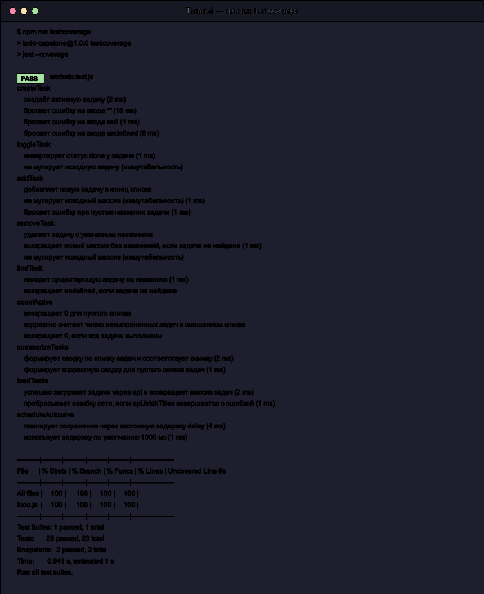

# Todo-модуль с полным покрытием тестами

[](https://github.com/l4yerzer0/jest-capstone-todo/actions/workflows/ci.yml)


Модуль управления задачами, спроектированный с нуля по методологии **TDD** (Test-Driven Development) и полностью покрытый unit-тестами на **Jest 30**.

---

## Что внутри

Модуль `src/todo.js` реализует 9 функций:

### Чистые функции (не мутируют входные данные, детерминированы)
- `createTask(title)` — создаёт новую задачу `{ title, done: false }`. Валидирует входные данные (выбрасывает ошибку на пустом значении).
- `toggleTask(task)` — возвращает копию задачи с инвертированным статусом `done`, не изменяя исходную задачу.
- `addTask(tasks, title)` — возвращает новый массив с добавленной задачей (созданной через `createTask`).
- `removeTask(tasks, title)` — возвращает новый массив без задачи с указанным `title`.
- `findTask(tasks, title)` — находит задачу по названию или возвращает `undefined`.
- `countActive(tasks)` — возвращает количество невыполненных (`done: false`) задач.
- `summarizeTasks(tasks)` — возвращает сводный объект `{ total, active, done, titles }`.

### Функции с зависимостями (изолированы в тестах)
- `loadTasks(api)` — асинхронная загрузка заголовков через `api.fetchTitles()` с конвертацией в задачи. Корректно пробрасывает ошибки сети.
- `scheduleAutosave(storage, tasks, delay = 1000)` — планирует вызов `storage.save(tasks)` через таймер `setTimeout` с дефолтной или переданной задержкой. Возвращает идентификатор таймера.

---

## Технологии

- **Jest 30** — современный тест-раннер и assertion library
- **Babel** (`@babel/preset-env`) — транспиляция ES-модулей
- **GitHub Actions** — автоматический CI пайплайн при каждом push и PR
- **Node.js**

---

## Запуск проекта и тестов

```bash
# Установка зависимостей
npm install

# Запуск тестов
npm test

# Запуск тестов в режиме отслеживания изменений
npm run test:watch

# Запуск тестов с генерацией отчёта о покрытии
npm run test:coverage
```

---

## Применённые техники тестирования (Портфолио-чеклист)

В тестовом наборе `src/todo.test.js` применены все ключевые техники курса:

1. **Матчеры значений**: глубокое сравнение объектов и массивов через `toEqual`.
2. **Проверка ошибок**: матчер `toThrow` с функциональной обёрткой `() => ...` для проверки валидации входных данных.
3. **Параметризация**: `test.each` для табличной проверки граничных и невалидных значений (`""`, `null`, `undefined`).
4. **Проверка иммутабельности**: использование `Object.freeze` и сверка ссылок (`not.toBe`), гарантирующие отсутствие мутации входных структур данных в чистых функциях (`toggleTask`, `addTask`, `removeTask`).
5. **Мокирование зависимостей**: изоляция внешних сервисов через `jest.fn()`, контроль вызовов с помощью `toHaveBeenCalledTimes` и `toHaveBeenCalledWith`.
6. **Асинхронное тестирование**: тестирование промисов через `mockResolvedValue` + `await`, а также обработка ошибок сети через `mockRejectedValue` + `rejects.toThrow`.
7. **Управление виртуальным временем**: `jest.useFakeTimers()`, проверка состояния до прокрутки (`not.toHaveBeenCalled()`), управление временной шкалой через `jest.advanceTimersByTime()`, очистка состояния в `afterEach` с `jest.useRealTimers()`. Отдельно протестирована ветка задержки по умолчанию (1000 мс).
8. **Snapshot-тестирование**: проверка структуры и консистентности ответа `summarizeTasks` через `toMatchSnapshot`.
9. **Контроль покрытия кода**: строгий порог `coverageThreshold: 90%` по всем метрикам (`statements`, `branches`, `functions`, `lines`). Достигнуто **100%** покрытие.

---

## Покрытие кода (100%)

| File | % Stmts | % Branch | % Funcs | % Lines | Uncovered Line #s |
| :--- | :---: | :---: | :---: | :---: | :---: |
| **All files** | **100%** | **100%** | **100%** | **100%** | |
| `todo.js` | 100% | 100% | 100% | 100% | — |



---

_Разработано в рамках курса «Основы автоматизированного тестирования на Jest»._
